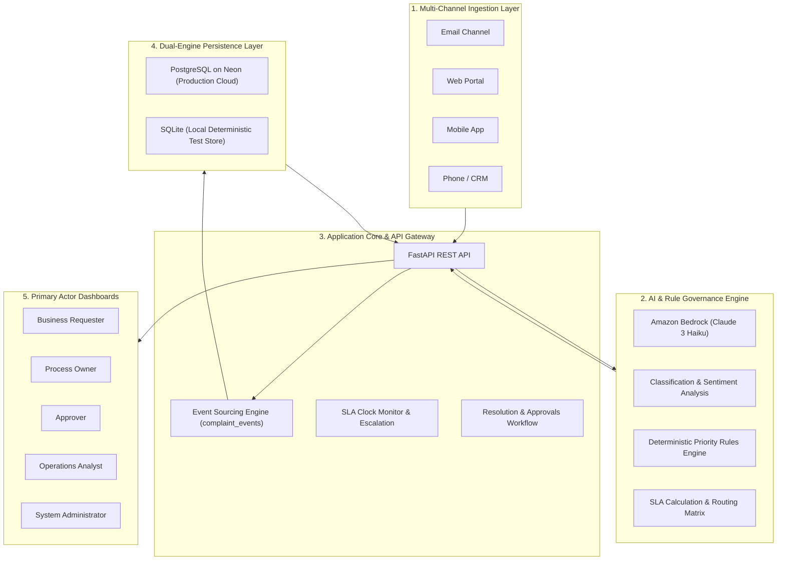
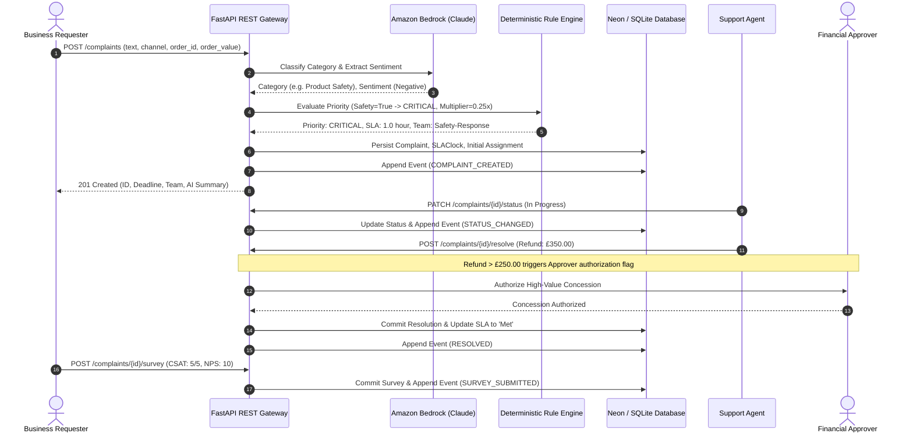
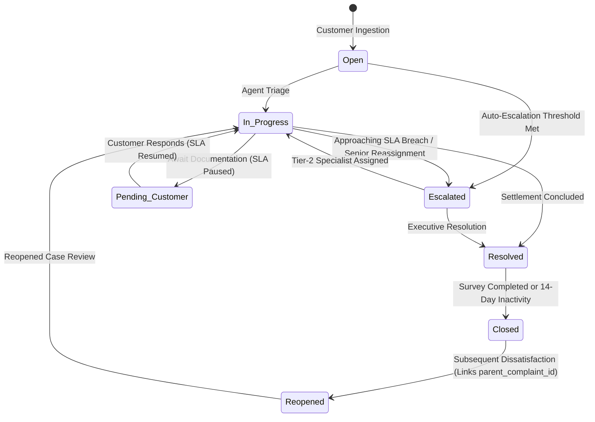

# Architecture & System Design — Complaint Lifecycle Engine
**System Context:** Associate AI Forward Deployed Engineer (FDE)  
**Core Technologies:** Amazon Bedrock (Claude 3 Haiku) | FastAPI | PostgreSQL (Neon) & SQLite | Pydantic v2

---

## 1. High-Level Architecture Overview

The **Complaint Lifecycle Engine** is an event-driven, AI-orchestrated microservice designed for multi-tier customer complaint management, automated SLA enforcement, and immutable auditability.

---

## 2. End-to-End Complaint Lifecycle Workflow

---

## 3. Complaint State Lifecycle Machine

---

## 4. SLA Governance & Escalation Matrix

The engine combines base SLA turnaround times by category with priority multipliers:
$$\text{SLA Hours} = \max\left(1.0, \text{default\_sla\_hours} \times \text{sla\_multiplier}\right)$$

| Category (`category_id`) | Base SLA | CRITICAL (0.25x) | HIGH (0.50x) | MEDIUM (1.00x) | LOW (1.50x) |
|---|---|---|---|---|---|
| **CAT-01: Billing & Payment** | 48 hrs | 12 hrs | 24 hrs | 48 hrs | 72 hrs |
| **CAT-02: Product Defect** | 72 hrs | 18 hrs | 36 hrs | 72 hrs | 108 hrs |
| **CAT-03: Delivery / Logistics** | 48 hrs | 12 hrs | 24 hrs | 48 hrs | 72 hrs |
| **CAT-04: Product Safety** | 4 hrs | **1 hr** | 2 hrs | 4 hrs | 6 hrs |
| **CAT-05: Customer Service** | 24 hrs | 6 hrs | 12 hrs | 24 hrs | 36 hrs |
| **CAT-06: Refund / Return** | 72 hrs | 18 hrs | 36 hrs | 72 hrs | 108 hrs |
| **CAT-07: Missing Order** | 24 hrs | 6 hrs | 12 hrs | 24 hrs | 36 hrs |
| **CAT-08: Technical / App Issue** | 96 hrs | 24 hrs | 48 hrs | 96 hrs | 144 hrs |
| **CAT-09: Fraud / Unauthorized** | 8 hrs | **2 hrs** | 4 hrs | 8 hrs | 12 hrs |
| **CAT-10: General Enquiry** | 120 hrs | 30 hrs | 60 hrs | 120 hrs | 180 hrs |

---

## 5. Primary Actor Role-Based Matrix

| Actor | Permitted API Actions | Audit Trail Event Generated |
|---|---|---|
| **Business Requester** | Submit complaint, send message, view status, submit CSAT/NPS survey. | `COMPLAINT_CREATED`, `MESSAGE_SENT`, `SURVEY_SUBMITTED`, `REOPENED` |
| **Process Owner** | Reassign cases, monitor breach rates, inspect queue depths, adjust priorities. | `ASSIGNED`, `STATUS_CHANGED`, `SLA_PAUSED`, `SLA_RESUMED` |
| **Approver** | Authorize high-value refunds (> £250.00), approve policy exceptions. | `RESOLUTION_APPROVED`, `RESOLVED` |
| **Operations Analyst** | Query `/analytics/summary`, inspect `/ground-truth`, evaluate model drift. | Read-only audit telemetry access. |
| **System Administrator** | Trigger generation pipelines (`run.py`), database migration, adjust SLA benchmarks. | System initialization, DDL execution, configuration updates. |

---

## 6. Dual-Engine Persistence Strategy

The system abstracts the database tier via `src/db.py`:
- **Neon (PostgreSQL):** When `DATABASE_URL` is configured (e.g. Neon connection string in `.env`), the application operates in enterprise cloud mode using `psycopg2` with foreign key enforcement and connection pooling.
- **SQLite:** When `DATABASE_URL` is unset, the engine defaults to `output/complaints.db`, maintaining zero-configuration local execution and 100% test independence.

---

## 7. AI Engine Resilience & Model Fallback

The AI layer in `src/ai_engine.py` invokes **Amazon Bedrock (Claude 3 Haiku)** via `boto3`:
1. If AWS credentials (`AWS_ACCESS_KEY_ID`, `AWS_SECRET_ACCESS_KEY`, `AWS_REGION`) are valid, calls Claude with structured zero-shot prompts and JSON schema output enforcement.
2. If credentials are unset or the network is unavailable, seamlessly falls back to a deterministic semantic keyword rule engine, ensuring 100% test suite reliability and offline execution without errors.

