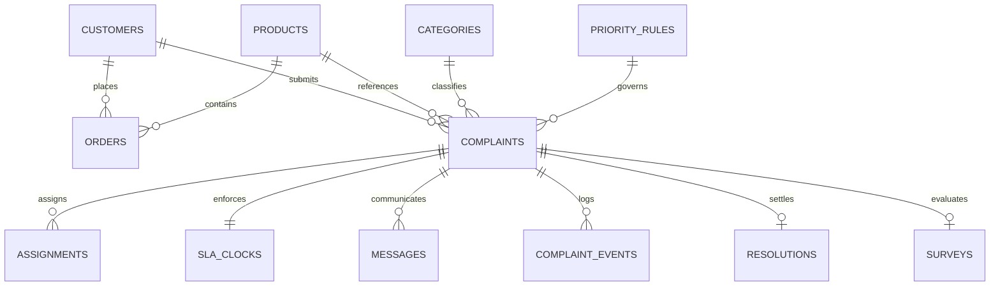

# Enterprise Data Dictionary — Complaint Lifecycle Engine

**System:** Complaint Lifecycle Engine & Deterministic SLA Orchestration Suite  
**Standard Specification:** Enterprise Forward Deployed Engineering (FDE) Architecture  
**Database Engines Supported:** PostgreSQL (Neon Cloud) & SQLite  
**Master Random Seed:** `20261022`  
**Standard Scale Baseline:** 5,000 Customers | 8,000 Orders | 2,000 Complaints | 6,000 Messages  

---

## 1. Architectural Overview & Entity-Relationship Schema

The data model follows an event-sourced, auditable domain schema designed to enforce zero data loss, chronological referential integrity, and deterministic business rules.

---

## 2. Core Entities Specification (11 Entities + Surveys)

### Entity 1: `customers`
Stores verified account holders, corporate clients, and guest requesters.

| Field Name | Type (PG / SQLite) | Nullable | Constraints & Keys | Allowed Values / Format | Description |
| :--- | :--- | :--- | :--- | :--- | :--- |
| `customer_id` | `VARCHAR(32)` / `TEXT` | No | **Primary Key** | Sequential `CUS-000001` to `CUS-005000` | Deterministic unique customer identifier |
| `first_name` | `VARCHAR(64)` / `TEXT` | No | None | Text (English/International) | Customer given name |
| `last_name` | `VARCHAR(64)` / `TEXT` | No | None | Text | Customer family name |
| `email` | `VARCHAR(128)` / `TEXT` | No | **Unique** | Valid RFC 5322 email | Primary customer communication channel |
| `phone` | `VARCHAR(32)` / `TEXT` | Yes | None | E.164 (e.g., `+44...`) | Telephone contact number |
| `segment` | `VARCHAR(32)` / `TEXT` | No | Enum | `Premium`, `Standard`, `Basic` | Business customer account tier |
| `is_vulnerable` | `BOOLEAN` / `INTEGER` | No | Default `FALSE` | `TRUE` / `FALSE` | Vulnerable customer flag (triggers CRITICAL SLA rule PR-01) |
| `registration_date` | `DATE` / `TEXT` | No | ISO 8601 Date | `YYYY-MM-DD` | Date account was onboarded |
| `lifetime_value` | `NUMERIC(10,2)` / `REAL` | No | Default `0.00` | `0.00` to `999999.99` (£ GBP) | Cumulative customer net transactional value |

---

### Entity 2: `products`
Master catalog of commercial products and merchandise items.

| Field Name | Type (PG / SQLite) | Nullable | Constraints & Keys | Allowed Values / Format | Description |
| :--- | :--- | :--- | :--- | :--- | :--- |
| `product_id` | `VARCHAR(32)` / `TEXT` | No | **Primary Key** | `PRD-001` to `PRD-015` | Unique catalog SKU code |
| `name` | `VARCHAR(128)` / `TEXT` | No | None | String (e.g. `SmartWatch Pro`) | Commercial product name |
| `category` | `VARCHAR(64)` / `TEXT` | No | None | `Electronics`, `Appliances`, etc. | Merchandising department |
| `price` | `NUMERIC(10,2)` / `REAL` | No | Check `> 0.00` | Numeric (£ GBP) | Standard retail item selling price |
| `safety_risk` | `BOOLEAN` / `INTEGER` | No | Default `FALSE` | `TRUE` / `FALSE` | Safety risk indicator (heating, battery, electrical) |

---

### Entity 3: `orders`
Historical purchases and fulfillment transactions.

| Field Name | Type (PG / SQLite) | Nullable | Constraints & Keys | Allowed Values / Format | Description |
| :--- | :--- | :--- | :--- | :--- | :--- |
| `order_id` | `VARCHAR(32)` / `TEXT` | No | **Primary Key** | Sequential `ORD-2026-000001` to `008000` | Deterministic transaction identifier |
| `customer_id` | `VARCHAR(32)` / `TEXT` | No | **Foreign Key** (`customers.customer_id`) | `CUS-%06d` | Purchasing customer |
| `product_id` | `VARCHAR(32)` / `TEXT` | No | **Foreign Key** (`products.product_id`) | `PRD-%03d` | Purchased merchandise SKU |
| `order_date` | `VARCHAR(32)` / `TEXT` | No | ISO 8601 Timestamp | `YYYY-MM-DDTHH:MM:SS` | Timestamp purchase was executed |
| `order_value` | `NUMERIC(10,2)` / `REAL` | No | Check `> 0.00` | Total checkout value (£ GBP) | Net transaction total |
| `quantity` | `INTEGER` | No | Check `>= 1` | `1` to `10` | Number of item units purchased |
| `status` | `VARCHAR(32)` / `TEXT` | No | Enum | `Pending`, `Processing`, `Shipped`, `Delivered`, `Cancelled`, `Returned` | Order fulfillment status |
| `delivery_date` | `VARCHAR(32)` / `TEXT` | Yes | Chronological Check | `YYYY-MM-DDTHH:MM:SS` (or null) | Carrier proof of delivery timestamp |

---

### Entity 4: `categories`
Hierarchical taxonomy for complaint triage and baseline SLA targets.

| Field Name | Type (PG / SQLite) | Nullable | Constraints & Keys | Allowed Values / Format | Description |
| :--- | :--- | :--- | :--- | :--- | :--- |
| `category_id` | `VARCHAR(16)` / `TEXT` | No | **Primary Key** | `CAT-01` to `CAT-10` | Master taxonomy node code |
| `name` | `VARCHAR(64)` / `TEXT` | No | **Unique** | E.g. `Billing & Payment`, `Product Safety` | Category display title |
| `default_sla_hours` | `INTEGER` | No | Check `> 0` | `4` to `120` hours | Standard baseline resolution deadline |

---

### Entity 5: `priority_rules`
Governance rules mapping customer, sentiment, and safety inputs to SLA tiers.

| Field Name | Type (PG / SQLite) | Nullable | Constraints & Keys | Allowed Values / Format | Description |
| :--- | :--- | :--- | :--- | :--- | :--- |
| `rule_id` | `VARCHAR(16)` / `TEXT` | No | **Primary Key** | `PR-01` to `PR-04` | Rule governance code |
| `priority` | `VARCHAR(16)` / `TEXT` | No | **Unique** | `CRITICAL`, `HIGH`, `MEDIUM`, `LOW` | Resulting priority level |
| `level` | `INTEGER` | No | **Unique** | `1` (highest) to `4` (lowest) | Numeric hierarchy rank |
| `description` | `TEXT` | No | None | Logic statement string | Plain English policy criteria |
| `sla_multiplier` | `NUMERIC(4,2)` / `REAL` | No | Check `> 0.0` | `0.25`, `0.50`, `1.00`, `1.50` | Factor applied against default SLA |
| `auto_escalate_hours` | `INTEGER` | No | Check `> 0` | `2`, `8`, `24`, `72` hours | Auto-escalation window |

---

### Entity 6: `complaints`
Central business record representing an ingested customer grievance.

| Field Name | Type (PG / SQLite) | Nullable | Constraints & Keys | Allowed Values / Format | Description |
| :--- | :--- | :--- | :--- | :--- | :--- |
| `complaint_id` | `VARCHAR(32)` / `TEXT` | No | **Primary Key** | Sequential `CMP-2026-000001` to `002000+` | Zero-padded complaint identifier |
| `customer_id` | `VARCHAR(32)` / `TEXT` | Yes | **Foreign Key** (`customers.customer_id`) | `CUS-%06d` (Empty on negative test case) | Submitting customer reference |
| `order_id` | `VARCHAR(32)` / `TEXT` | Yes | Optional Reference | `ORD-2026-%06d` | Associated purchase transaction |
| `product_id` | `VARCHAR(32)` / `TEXT` | Yes | Optional Reference | `PRD-%03d` | Product SKU referenced |
| `category_id` | `VARCHAR(16)` / `TEXT` | No | **Foreign Key** (`categories.category_id`) | `CAT-01` to `CAT-10` | Inferred category code |
| `category_name` | `VARCHAR(64)` / `TEXT` | No | None | Category name string | Category name snapshot |
| `channel` | `VARCHAR(32)` / `TEXT` | No | Enum | `Email`, `Phone`, `Web`, `Mobile App`, `Social Media`, `In-Store` | Ingestion channel |
| `severity` | `VARCHAR(16)` / `TEXT` | No | Enum | `Critical`, `High`, `Medium`, `Low` | Severity rating |
| `priority` | `VARCHAR(16)` / `TEXT` | No | Enum | `CRITICAL`, `HIGH`, `MEDIUM`, `LOW` | Evaluated priority tier |
| `sentiment` | `VARCHAR(16)` / `TEXT` | No | Enum | `Positive`, `Neutral`, `Negative` | NLP sentiment polarity |
| `status` | `VARCHAR(32)` / `TEXT` | No | Enum | `Open`, `In Progress`, `Pending Customer`, `Escalated`, `Resolved`, `Closed`, `Reopened` | Lifecycle workflow state |
| `created_at` | `VARCHAR(32)` / `TEXT` | No | ISO 8601 Timestamp | `YYYY-MM-DDTHH:MM:SS` | Intake timestamp |
| `updated_at` | `VARCHAR(32)` / `TEXT` | No | ISO 8601 Timestamp | `YYYY-MM-DDTHH:MM:SS` | Latest state change timestamp |
| `recurrence_count` | `INTEGER` | No | Default `1` | Integer `>= 1` | Number of complaints filed by customer |
| `is_safety_issue` | `BOOLEAN` / `INTEGER` | No | Default `FALSE` | `TRUE` / `FALSE` | Product hazard or burn/injury risk |
| `is_reopened` | `BOOLEAN` / `INTEGER` | No | Default `FALSE` | `TRUE` / `FALSE` | Reopened case flag |
| `parent_complaint_id` | `VARCHAR(32)` / `TEXT` | Yes | Self-reference | `CMP-2026-%06d` | Parent ticket for reopened/repeat issues |
| `order_value` | `NUMERIC(10,2)` / `REAL` | No | Default `0.00` | Numeric (£ GBP) | Order financial exposure |
| `ai_classification` | `TEXT` | Yes | None | JSON serialization string | Raw AI / Bedrock classification payload |
| `ai_summary` | `TEXT` | Yes | None | Text | Synthesized case summary |

---

### Entity 7: `complaint_events`
Immutable event sourcing journal recording state transitions and actor actions.

| Field Name | Type (PG / SQLite) | Nullable | Constraints & Keys | Allowed Values / Format | Description |
| :--- | :--- | :--- | :--- | :--- | :--- |
| `event_id` | `VARCHAR(64)` / `TEXT` | No | **Primary Key** | Sequential `EVT-000001` to `EVT-006000+` | Unique immutable event ID |
| `complaint_id` | `VARCHAR(32)` / `TEXT` | No | **Foreign Key** (`complaints.complaint_id`) | `CMP-2026-%06d` | Target complaint reference |
| `event_type` | `VARCHAR(32)` / `TEXT` | No | Enum | `COMPLAINT_CREATED`, `ASSIGNED`, `STATUS_CHANGED`, `SLA_PAUSED`, `SLA_RESUMED`, `SLA_BREACHED`, `MESSAGE_SENT`, `MESSAGE_RECEIVED`, `RESOLVED`, `SURVEY_SUBMITTED`, `REOPENED` | Discrete domain event type |
| `actor` | `VARCHAR(64)` / `TEXT` | No | None | Actor name, agent ID, or system | User or service triggering event |
| `old_state` | `VARCHAR(32)` / `TEXT` | Yes | None | Status string or blank | Prior lifecycle state |
| `new_state` | `VARCHAR(32)` / `TEXT` | No | None | Status string or team name | Subsequent lifecycle state |
| `event_timestamp` | `VARCHAR(32)` / `TEXT` | No | ISO 8601 Timestamp | `YYYY-MM-DDTHH:MM:SS` | Exact wall-clock event time |
| `details` | `TEXT` | Yes | None | Text | Human-readable audit narrative |

---

### Entity 8: `assignments`
Operational ownership and queue routing history.

| Field Name | Type (PG / SQLite) | Nullable | Constraints & Keys | Allowed Values / Format | Description |
| :--- | :--- | :--- | :--- | :--- | :--- |
| `assignment_id` | `VARCHAR(32)` / `TEXT` | No | **Primary Key** | Sequential `ASN-000001` to `ASN-002000+` | Unique assignment record code |
| `complaint_id` | `VARCHAR(32)` / `TEXT` | No | **Foreign Key** (`complaints.complaint_id`) | `CMP-2026-%06d` | Associated complaint ticket |
| `team` | `VARCHAR(64)` / `TEXT` | No | Enum | `Safety-Response`, `Fraud-Team`, `Senior-Support`, `Escalations`, `Standard-Support`, `General-Support` | Operational queue unit |
| `agent_id` | `VARCHAR(32)` / `TEXT` | No | None | `AGT-SR-01`, `AGT-SS-01`, etc. | Assigned employee agent badge |
| `assigned_at` | `VARCHAR(32)` / `TEXT` | No | ISO 8601 Timestamp | `YYYY-MM-DDTHH:MM:SS` | Timestamp assignment occurred |
| `is_current` | `BOOLEAN` / `INTEGER` | No | Default `TRUE` | `TRUE` / `FALSE` | Active ownership indicator |
| `reason` | `TEXT` | Yes | None | Text | Routing justification rationale |

---

### Entity 9: `sla_clocks`
Deterministic SLA stopwatch tracking active duration, pauses, and breach states.

| Field Name | Type (PG / SQLite) | Nullable | Constraints & Keys | Allowed Values / Format | Description |
| :--- | :--- | :--- | :--- | :--- | :--- |
| `sla_id` | `VARCHAR(32)` / `TEXT` | No | **Primary Key** | Sequential `SLA-000001` to `SLA-002000+` | Unique SLA tracker ID |
| `complaint_id` | `VARCHAR(32)` / `TEXT` | No | **Foreign Key** (`complaints.complaint_id`) | `CMP-2026-%06d` | Target complaint ticket |
| `sla_hours` | `NUMERIC(6,2)` / `REAL` | No | Check `> 0.0` | `1.00` to `180.00` hours | Enforced maximum duration |
| `started_at` | `VARCHAR(32)` / `TEXT` | No | ISO 8601 Timestamp | `YYYY-MM-DDTHH:MM:SS` | Stopwatch start time |
| `deadline_at` | `VARCHAR(32)` / `TEXT` | No | ISO 8601 Timestamp | `YYYY-MM-DDTHH:MM:SS` | Guaranteed completion deadline |
| `paused_at` | `VARCHAR(32)` / `TEXT` | Yes | ISO 8601 Timestamp | `YYYY-MM-DDTHH:MM:SS` (or null) | Timestamp SLA clock was halted |
| `resumed_at` | `VARCHAR(32)` / `TEXT` | Yes | ISO 8601 Timestamp | `YYYY-MM-DDTHH:MM:SS` (or null) | Timestamp SLA clock restarted |
| `pause_reason` | `TEXT` | Yes | None | Text | Justification for timer pause |
| `is_breached` | `BOOLEAN` / `INTEGER` | No | Default `FALSE` | `TRUE` / `FALSE` | Target deadline breach indicator |
| `breached_at` | `VARCHAR(32)` / `TEXT` | Yes | ISO 8601 Timestamp | `YYYY-MM-DDTHH:MM:SS` (or null) | Timestamp deadline expired |
| `status` | `VARCHAR(16)` / `TEXT` | No | Enum | `Active`, `Paused`, `Met`, `Breached` | Current SLA stopwatch state |

---

### Entity 10: `messages`
Full customer-agent interaction log and internal collaboration notes.

| Field Name | Type (PG / SQLite) | Nullable | Constraints & Keys | Allowed Values / Format | Description |
| :--- | :--- | :--- | :--- | :--- | :--- |
| `message_id` | `VARCHAR(64)` / `TEXT` | No | **Primary Key** | Sequential `MSG-000001` to `MSG-006000+` | Unique communication message code |
| `complaint_id` | `VARCHAR(32)` / `TEXT` | No | **Foreign Key** (`complaints.complaint_id`) | `CMP-2026-%06d` | Parent complaint thread |
| `sender_type` | `VARCHAR(16)` / `TEXT` | No | Enum | `Customer`, `Agent`, `System` | Message author party |
| `message_text` | `TEXT` | No | Non-empty | Text | Content of communication |
| `sent_at` | `VARCHAR(32)` / `TEXT` | No | ISO 8601 Timestamp | `YYYY-MM-DDTHH:MM:SS` | Timestamp dispatch occurred |
| `is_internal` | `BOOLEAN` / `INTEGER` | No | Default `FALSE` | `TRUE` / `FALSE` | Internal caseworker note flag |

---

### Entity 11: `resolutions`
Legal and financial settlement sign-off committing case closure.

| Field Name | Type (PG / SQLite) | Nullable | Constraints & Keys | Allowed Values / Format | Description |
| :--- | :--- | :--- | :--- | :--- | :--- |
| `resolution_id` | `VARCHAR(32)` / `TEXT` | No | **Primary Key** | Sequential `RES-000001` to `RES-000800+` | Unique resolution certificate ID |
| `complaint_id` | `VARCHAR(32)` / `TEXT` | No | **Foreign Key** (`complaints.complaint_id`) | `CMP-2026-%06d` | Resolved complaint ticket |
| `resolution_type` | `VARCHAR(32)` / `TEXT` | No | Enum | `Refund`, `Replacement`, `Apology`, `Fix Applied`, `Escalated Externally`, `No Action Required` | Formal closure strategy |
| `resolved_by` | `VARCHAR(32)` / `TEXT` | No | None | Agent ID (e.g. `AGT-SR-01`) | Authorizing caseworker |
| `resolved_at` | `VARCHAR(32)` / `TEXT` | No | ISO 8601 Timestamp | `YYYY-MM-DDTHH:MM:SS` | Closure commit timestamp |
| `notes` | `TEXT` | Yes | None | Text | Settlement justification remarks |
| `refund_amount` | `NUMERIC(10,2)` / `REAL` | Yes | Default `0.00` | `0.00` to `9999.99` (£ GBP) | Refund sum (> £250 requires Approver) |

---

### Supplementary Entity: `surveys`
Customer satisfaction (CSAT) and Net Promoter Score (NPS) feedback.

| Field Name | Type (PG / SQLite) | Nullable | Constraints & Keys | Allowed Values / Format | Description |
| :--- | :--- | :--- | :--- | :--- | :--- |
| `survey_id` | `VARCHAR(32)` / `TEXT` | No | **Primary Key** | Sequential `SRV-000001` to `SRV-000800+` | Unique survey evaluation code |
| `complaint_id` | `VARCHAR(32)` / `TEXT` | No | **Foreign Key** (`complaints.complaint_id`) | `CMP-2026-%06d` | Evaluated complaint ticket |
| `rating` | `INTEGER` | No | Check `1 <= rating <= 5` | `1` (Terrible) to `5` (Excellent) | CSAT star rating |
| `feedback_text` | `TEXT` | Yes | None | Text | Customer verbatim comments |
| `submitted_at` | `VARCHAR(32)` / `TEXT` | No | ISO 8601 Timestamp | `YYYY-MM-DDTHH:MM:SS` | Customer submission time |
| `nps_score` | `INTEGER` | Yes | Check `0 <= nps <= 10` | `0` (Detractor) to `10` (Promoter) | Net Promoter Score index |

---

## 3. Negative Test Cases & Anomaly Injection Specification

To rigorously evaluate observability and data governance pipelines, exactly 6 mandatory negative test cases are injected into deterministic sequential tickets (`CMP-2026-000001` through `CMP-2026-000006`) and completely isolated in `output/ground_truth/` to prevent label leakage into ML training sets:

| Test Case | Target Entity | Injected Record | Defect Type | Validation Rule Triggered | Isolated Ground Truth File |
| :--- | :--- | :--- | :--- | :--- | :--- |
| **1. Missing Customer** | `complaints` | `CMP-2026-000001` | Null/empty `customer_id` | `FK_CUSTOMER_MISSING` | `ground_truth.json` / `csv` |
| **2. Inverted Resolution** | `resolutions` | `RES-000001` (on `CMP-2026-000002`) | `resolved_at < created_at` | `DATE_RESOLUTION_BEFORE_COMPLAINT` | `ground_truth.json` / `csv` |
| **3. Unresumed SLA Pause** | `sla_clocks` | `SLA-000003` (on `CMP-2026-000003`) | `paused_at` set with no `resumed_at` | `DATE_SLA_PAUSE_NO_RESUME` | `ground_truth.json` / `csv` |
| **4. Unlinked Repeat Issue** | `complaints` | `CMP-2026-000004` | `recurrence_count=3` with null parent | `REPEAT_ISSUE_NOT_LINKED` | `ground_truth.json` / `csv` |
| **5. Safety Queue Misroute** | `complaints`, `assignments` | `CMP-2026-000005` | Safety risk assigned to `General-Support` (LOW) | `PRIORITY_SAFETY_ANOMALY` | `ground_truth.json` / `csv` |
| **6. Premature Survey** | `surveys` | `SRV-000001` (on `CMP-2026-000006`) | `submitted_at < resolved_at` | `DATE_SURVEY_BEFORE_CLOSURE` | `ground_truth.json` / `csv` |
